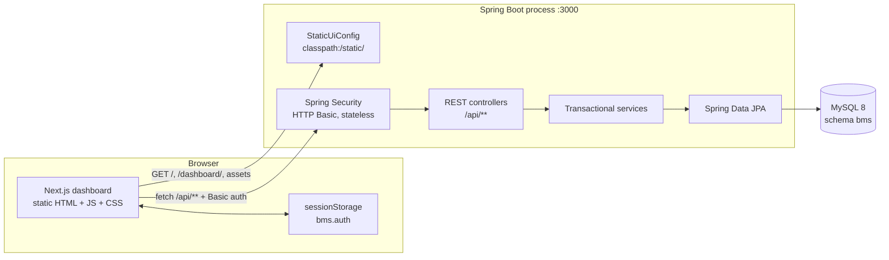
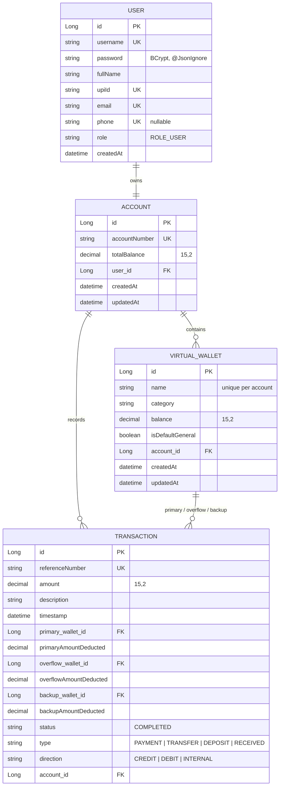

# BMS — Banking Management System with Virtual Wallet Management

> **Review 2 — code and architecture reference.**
> BMS is a full-stack banking demo: a **Spring Boot 3.2.4 (Java 21) REST + MySQL** backend
> implementing a ring-fenced **virtual wallet ledger**, a **multi-tier overflow payment engine**,
> and a **Probability & Statistics (P&S) analytics engine**, paired with a **Next.js 14 +
> TypeScript + Tailwind** dashboard.
>
> **There is exactly one website, one process, and one port.** The Spring Boot application
> serves both the REST API (`/api/**`) and the statically exported Next.js dashboard (from
> `classpath:/static/`) on **http://localhost:3000**. No second UI exists, and nothing runs on
> another port in normal use.

---

## Table of contents

1. [What BMS is](#1-what-bms-is)
2. [At a glance](#2-at-a-glance)
3. [Repository layout](#3-repository-layout)
4. [Technology stack](#4-technology-stack)
5. [Architecture: one process, one port](#5-architecture-one-process-one-port)
6. [Domain model](#6-domain-model)
7. [Core business rules](#7-core-business-rules)
8. [Multi-tier overflow payment engine](#8-multi-tier-overflow-payment-engine)
9. [Account-to-account transfer](#9-account-to-account-transfer)
10. [Wallet management](#10-wallet-management)
11. [Probability and statistics engine](#11-probability-and-statistics-engine)
12. [REST API reference](#12-rest-api-reference)
13. [Error handling](#13-error-handling)
14. [Security model](#14-security-model)
15. [Configuration reference](#15-configuration-reference)
16. [Seed data and demo credentials](#16-seed-data-and-demo-credentials)
17. [Frontend routes and features](#17-frontend-routes-and-features)
18. [Building and running](#18-building-and-running)
19. [Testing](#19-testing)
20. [Known gaps and demo caveats](#20-known-gaps-and-demo-caveats)
21. [Review 2 talking points](#21-review-2-talking-points)
22. [Glossary](#22-glossary)

---

## 1. What BMS is

BMS models a single bank **account** whose balance is split across multiple logical **virtual
wallets** (General, Savings, Food, Travel, Shopping, …). Spending is never taken from an opaque
balance — it is deducted from wallets using a **multi-tier overflow algorithm** — and every
mutating operation upholds the core accounting invariant:

```
      Σ (virtual_wallet.balance)  ==  account.total_balance
```

On top of the ledger sits a **descriptive-statistics engine** that answers questions such as
*"what is the mean / median / variance of spending from this wallet, and what is
P(X > ₹500)?"* — the P&S component required by the course.

The product is delivered as **one website**:

| Concern | Stack | Location | Port |
|---|---|---|---|
| **The dashboard and the API** | Spring Boot 3.2.4 serving Next.js 14 static export **and** `/api/**` | Unified repository (`src/main/resources/static/` + Java backend) | **`3000`** |

The application is **BMS** (Banking Management System).

---

## 2. At a glance

| Item | Value |
|---|---|
| Product name | **BMS** (Banking Management System) |
| Maven coordinates | `com.banking:virtual-wallet-system:1.0.0` |
| Spring Boot | `3.2.4` |
| Java | `21` |
| Build | Maven wrapper (`mvnw.cmd`) bundled with Apache Maven **3.9.6** in `.mvn-bin/` |
| Database | MySQL 8 — schema **`bms`** (`ddl-auto=update`) |
| Runtime | **One Spring Boot process on port `3000`** |
| App URL (UI + API) | `http://localhost:3000` |
| Swagger UI | `http://localhost:3000/swagger-ui.html` |
| OpenAPI spec | `http://localhost:3000/v3/api-docs` |
| Dashboard bundle | Bundled in `src/main/resources/static/` |
| Default login | `karthik` / `password123` |
| Backend package root | `com.banking.virtualwallet` |
| Course reference PDF | `Online Banking System with Virtual Wallet Management _ Gamma.pdf` |

---

## 3. Repository layout

The codebase is organized as a unified, self-contained Maven project:

```
BankingManagementSystem-main/
├── pom.xml                            # Maven build: Java 21, Spring Boot 3.2.4
├── mvnw.cmd                           # Bundled Maven wrapper launcher
├── run.bat                            # Single-click launcher (banner + spring-boot:run)
├── README.md                          # Complete technical & architecture reference
└── src/
    ├── main/
    │   ├── java/com/banking/virtualwallet/
    │   │   ├── VirtualWalletApplication.java      # Spring Boot application entry point
    │   │   ├── config/
    │   │   │   ├── SecurityConfig.java            # Stateless HTTP Basic filter chain, CORS, BCrypt
    │   │   │   ├── StaticUiConfig.java            # Serves static web app on port 3000 alongside /api
    │   │   │   ├── DataInitializer.java           # CommandLineRunner — seeds demo users, wallets & history
    │   │   │   └── OpenApiConfig.java             # OpenAPI 3.0 / Swagger UI metadata
    │   │   ├── controller/
    │   │   │   ├── AuthRestController.java        # /api/auth (login, register, me, phone lookup)
    │   │   │   ├── AccountRestController.java     # /api/account (summary, deposit, inter-account transfer)
    │   │   │   ├── WalletRestController.java      # /api/wallets (CRUD, reallocate, wallet-to-wallet)
    │   │   │   ├── TransactionRestController.java # /api/transactions (multi-tier payment, ledger)
    │   │   │   ├── AnalyticsRestController.java   # /api/analytics (descriptive statistics & P(X > k))
    │   │   │   └── GlobalExceptionHandler.java    # Centralized @RestControllerAdvice error handling
    │   │   ├── dto/
    │   │   │   ├── AuthDTOs.java                  # Login, Register, AuthResponse contracts
    │   │   │   ├── TransactionDTOs.java           # Payment, Deposit, Transfer, InsufficientFunds DTOs
    │   │   │   ├── WalletDTOs.java                # Wallet CRUD, Reallocate, AccountResponse contracts
    │   │   │   └── StatisticalMetricsResponse.java# Mean, Median, Variance, Quartiles, Frequency buckets
    │   │   ├── entity/                            # JPA entities: User, Account, VirtualWallet, Transaction
    │   │   ├── repository/                        # Spring Data JPA repositories
    │   │   └── service/                           # Transactional business logic & P&S analytics
    │   └── resources/
    │       ├── application.properties             # Port 3000, MySQL datasource, JPA configs
    │       └── static/                            # Production Next.js 14 web app bundle
    │           ├── _next/static/                  # Pre-compiled JavaScript chunks, CSS & fonts
    │           ├── dashboard/index.html           # Authenticated financial dashboard & smart wallets
    │           ├── transfers/index.html           # Send money (Phone, UPI, Account No, Quick Pay)
    │           ├── analytics/index.html           # Probability & statistics visualization engine
    │           ├── profile/index.html             # User identity, linked UPI & QR code
    │           ├── login/index.html               # Authentication portal with password visibility toggle
    │           ├── register/index.html            # Self-service user registration
    │           ├── about/index.html               # About BMS platform
    │           ├── faq/index.html                 # Frequently asked questions
    │           ├── privacy/index.html             # Privacy policy
    │           └── terms/index.html               # Terms of service
    └── test/java/com/banking/virtualwallet/
        ├── WalletServiceTest.java
        ├── TransactionServiceTest.java
        └── AnalyticsServiceTest.java
```

---

## 4. Technology stack

### 4.1 Backend

| Concern | Choice |
|---|---|
| Language / runtime | Java 21 |
| Framework | Spring Boot 3.2.4 |
| Build | Maven (wrapper + bundled Maven 3.9.6) |
| Web | Spring Web MVC — REST controllers only; no server-side HTML view engine |
| Persistence | Spring Data JPA / Hibernate |
| Database | MySQL 8 — schema `bms` (`ddl-auto=update`) |
| Security | Spring Security 6 — HTTP Basic, BCrypt, stateless sessions |
| Validation | Jakarta Bean Validation (`spring-boot-starter-validation`) |
| API docs | springdoc-openapi `2.3.0` / Swagger UI |
| Testing | JUnit 5 + Mockito (`spring-boot-starter-test`, `spring-security-test`) |

**Declared Maven dependencies** (`pom.xml`): `spring-boot-starter-web`,
`spring-boot-starter-data-jpa`, `spring-boot-starter-validation`,
`spring-boot-starter-security`, `com.h2database:h2` (runtime, unused at runtime),
`com.mysql:mysql-connector-j` (runtime), `springdoc-openapi-starter-webmvc-ui`,
`spring-boot-starter-test`, `spring-security-test`. Build plugin:
`spring-boot-maven-plugin`. Property `springdoc.version = 2.3.0`.

### 4.2 Frontend (`bms-dashboard`)

| Concern | Choice |
|---|---|
| Framework | Next.js `^14.2.4` (App Router), statically exported |
| Language | TypeScript `^5` (`strict`) |
| UI library | React `^18.3.1` |
| Styling | Tailwind CSS `^3.4.4` + `autoprefixer` + `postcss` |
| Charts | `recharts` `^3.10.1` |
| Icons | `lucide-react` `^0.344.0` |
| QR code | `qrcode.react` `^4.2.0` |
| Fonts | `next/font/google` — **Inter** + **Plus Jakarta Sans** |
| API client | Hand-written `fetch` wrapper (`src/lib/api.ts`) |
| Lint | `eslint` `^8` + `eslint-config-next` |
| Export | `output: "export"`, `trailingSlash: true`, `images.unoptimized: true` |

---

## 5. Architecture: one process, one port

### 5.1 The single-port runtime



Request flow for any API call:
`Browser → HTTP Basic header → SecurityFilterChain → Controller → @Transactional Service →
JPA Repository → MySQL`.

In the deployed application the browser talks to **one origin**, `http://localhost:3000`:

- `/` and extension-less routes are served the static Next.js shell.
- `/dashboard/`, `/login/`, `/transfers/`, `/analytics/`, `/profile/`, `/register/` map to the
  exported directories and their `index.html`.
- `/_next/**` serves the exported JavaScript, CSS, and font assets.
- `/api/**` is handled by the REST controllers.
- `/swagger-ui.html` and `/v3/api-docs` are served by springdoc.

### 5.2 How the static export is served

`config/StaticUiConfig.java` registers a resource handler for `/**` rooted at
`classpath:/static/`:

1. **Never swallow API traffic.** A request path starting with `api/` is returned as `null`, so
   the REST controllers (and the exception handler) answer it.
2. **Direct file.** If the requested path exists as a readable resource, it is served.
3. **Directory route.** Because the export uses `trailingSlash`, `/dashboard` resolves to
   `dashboard/index.html`.
4. **SPA fallback.** An unknown **extension-less** path returns the root `index.html`, allowing
   client-side routing and deep links to resolve instead of returning 404. Paths containing a
   `.` (for example a stale JS chunk or font) are allowed to 404.

`GlobalExceptionHandler` returns a bare **404** for `NoResourceFoundException`, because Spring
presets the response content type from the missing file's extension and a JSON body would fail
to serialize.

### 5.3 Production static web bundle

The production Next.js 14 dashboard and public pages are pre-compiled and bundled inside:
`src/main/resources/static/`

Spring Boot packs these static resources into the application classpath (`classpath:/static/`) during Maven compilation. When `VirtualWalletApplication` starts on port `3000`, `StaticUiConfig` routes browser requests to their respective HTML files (with `trailingSlash`) and static JS/CSS chunks, while preserving `/api/**` for Spring REST controllers.

Whenever static assets in `src/main/resources/static` are modified, restarting the Spring Boot process (or running `.\mvnw.cmd test-compile -DskipTests`) ensures `target/classes/static` is refreshed.

---

## 6. Domain model



### Entity notes

- **`User`** (`users`): `username` unique; `password` is BCrypt-hashed and `@JsonIgnore`d;
  `upiId` unique (`<username>@okbms` for users created through registration); `email`/`phone`
  unique; `role` defaults to `ROLE_USER`; `account` is a lazy `@OneToOne(mappedBy="user")`.
- **`Account`** (`accounts`): `accountNumber` unique; `totalBalance` is `BigDecimal(15,2)`;
  `user` is a lazy `@OneToOne` (`user_id` FK); `wallets` is a lazy `@OneToMany`
  (`cascade=ALL, orphanRemoval=true`); `@PreUpdate` bumps `updatedAt`.
- **`VirtualWallet`** (`virtual_wallets`): unique constraint on **`(account_id, name)`**;
  `balance` is `BigDecimal(15,2)`; `isDefaultGeneral` flags the single General wallet.
- **`Transaction`** (`transactions`): `referenceNumber` unique; up to **three** wallet references
  (`primaryWallet` required, `overflowWallet`/`backupWallet` optional), each with a matching
  `*AmountDeducted`; `type` ∈ `PAYMENT | TRANSFER | DEPOSIT | RECEIVED`; `direction` ∈
  `CREDIT | DEBIT | INTERNAL`. All money is `BigDecimal(15,2)` — **never `double`**.
  `account` is `@JsonIgnore`d and lazy.

`Transaction.direction` records cash flow relative to the owning account: `CREDIT` (money in),
`DEBIT` (money out), `INTERNAL` (wallet-to-wallet reallocation). It is set explicitly by each
service so the ledger never has to infer inflow/outflow from `type`; the frontend still derives
a direction for any legacy row that lacks the column.

---

## 7. Core business rules

### 7.1 The balance invariant

The sum of all wallet balances must equal the account's total balance. Every mutating path
upholds this by construction:

| Operation | Effect on wallets | Effect on account |
|---|---|---|
| **Deposit** | General wallet `+= amount` | `totalBalance += amount` |
| **Create wallet** | General `−= allocation`; new wallet `+= allocation` | unchanged |
| **Delete wallet** | remaining balance refunded to General | unchanged |
| **Reallocate** | new balances set (must sum to total) | unchanged |
| **Wallet→wallet transfer** | from `−= amount`; to `+= amount` | unchanged |
| **Payment (multi-tier)** | deduct across primary (+ overflow + backup) | `totalBalance −= amount` |
| **Account→account transfer** | source wallet `−=`; recipient General `+=` | sender `−=`; recipient `+=` |

`AccountService.getAccountDetails()` recomputes `Σ wallets` and returns a `balanced` boolean so
the UI can surface any drift (`totalWalletsBalance` vs `totalBalance`).

### 7.2 Other guard rails

- Registration rejects duplicate username, email, and phone.
- Deposits must be positive; the request DTO additionally enforces a minimum of ₹1.00.
- Wallet names are unique per account (case-insensitive) and capped at 40 characters on rename.
- The General wallet cannot be deleted.
- Reallocation rejects negatives, foreign wallet IDs, and any set of balances that does not
  **exactly** equal the account total.
- A payment is rejected if the total account balance cannot cover it.
- All mutating service methods are `@Transactional` — a mid-operation failure rolls back the
  ledger.

---

## 8. Multi-tier overflow payment engine

Implemented in `TransactionService.processPayment(...)` (`@Transactional`). A payment is charged
against a **primary** wallet, with automatic overflow:

```
Tier 1  ── Primary (target) wallet covers the full amount? -> done.
           Otherwise drain it to zero and compute the deficit.

Tier 2  ── If primary != General: the General wallet absorbs the deficit.
           - General covers it -> done (auto-overflow)
           - General is short  -> drain General to zero, compute remaining deficit -> Tier 3

Tier 3  ── Remaining deficit must come from a caller-supplied backupWalletId:
           - valid backup with enough funds -> three-way split
           - otherwise -> throw InsufficientFundsNeedBackupException
             (listing eligible backup wallets)

Special case: if the primary IS the General wallet and it cannot cover the amount,
              the caller must supply a backupWalletId or the exception is raised.
```

Before any deduction the service also checks the **total account balance** is sufficient and
that the target wallet belongs to the caller's account.

The exception is translated by `GlobalExceptionHandler` into an **HTTP 400** body of type
`INSUFFICIENT_FUNDS_NEED_BACKUP` that includes `requestedAmount`, `availablePrimary`,
`availableGeneral`, `deficit`, and `eligibleWallets` (non-General wallets whose balance ≥ the
deficit), so the client can prompt the user to choose one. The whole operation is transactional,
so the drained balances are rolled back when the exception is thrown.

On success the service records one `Transaction` (type `PAYMENT`, direction `DEBIT`) capturing
the exact split, and returns a `PaymentResponse` with the reference number, per-tier wallet
names/amounts, remaining balances, and a human-readable status message.

---

## 9. Account-to-account transfer

`AccountService.transferBetweenAccounts(...)` is fully `@Transactional` (all-or-nothing):

1. Resolve the recipient by **UPI id** (`toUpiId`) when supplied, otherwise by **account number**
   (`toAccountNumber`).
2. Reject self-transfers and an insufficient account balance.
3. Resolve the funding wallet: an explicit `fromWalletId` (validated to belong to the sender),
   otherwise the sender's **General** wallet.
4. Verify the chosen source wallet holds enough funds.
5. Debit the source wallet and the sender's account total; credit the recipient's General wallet
   and the recipient's account total.
6. Write **two** ledger entries:
   - `TRANSFER` / `direction=DEBIT` on the sender (`referenceNumber` prefix `ATX-`)
   - `RECEIVED` / `direction=CREDIT` on the recipient

   sharing the same amount and a readable description.
7. Return a map with `message`, `referenceNumber`, `newBalance`, and `sourceWallet`.

---

## 10. Wallet management

- **Get wallets** — returns each wallet with its `percentageOfTotal` (balance ÷ account total,
  rounded to 1 dp). Lazily self-heals by calling `ensureGeneralWalletExists()`.
- **Create** — name must be unique per account (case-insensitive); the initial allocation
  (`≥ 0`, default `0`) is pulled from General and rejected if General lacks the funds.
- **Rename** — uniqueness enforced case-insensitively; name trimmed and limited to 40 chars;
  balance untouched.
- **Delete** — the default General wallet is protected; any remaining balance is refunded to
  General first, then the wallet is removed.
- **Wallet→wallet transfer** — moves an allocation between two of the user's own wallets; writes
  a `TRANSFER` / `INTERNAL` transaction. Source and destination must differ.
- **Reallocate** — sets new balances for the supplied wallets; the new total must **exactly**
  equal the account total, else the request is rejected. Negative balances and foreign wallet
  IDs are rejected.
- `ensureGeneralWalletExists()` creates a General wallet with the full account balance if an
  account somehow lacks one.

### 10.1 The Wallet Category System

Each virtual wallet can be tagged with an optional category (e.g., *General Purpose*, *Emergency & Savings*, *Groceries & Dining*, *Commute & Transit*, *Lifestyle & Retail*, *Bills & Utilities*).
- **Purpose**: Categories act as budgeting tags and metadata for statistical analysis, spending visualization, and dashboard grouping.
- **Ledger Invariant Preserved**: Categorization does not restrict wallet functionality or liquidity — all wallets participate identically in the balance invariant (`Σ wallets == totalBalance`) and the multi-tier overflow payment engine.
- **Default Category**: When creating a wallet without an explicit category, it defaults to `"General Category"`.

---

## 11. Probability and statistics engine

The statistics exist in two places, both part of the single website: the authoritative **Java
service** behind `/api/analytics`, and a **client-side mirror** used by the `/analytics` page.

### 11.1 Backend — `AnalyticsService`

`GET /api/analytics/{walletId}?threshold=500` (and the alias `/api/analytics/wallet/{walletId}`)
returns a `StatisticalMetricsResponse` computed from
`TransactionRepository.findCompletedByPrimaryWalletId(walletId)` — only `COMPLETED` transactions
charged to that wallet as the **primary** wallet.

| Metric | Formula / meaning |
|---|---|
| Count | `n` transactions |
| Total spent | `Σ xᵢ` (the full transaction amount, not the primary share of a split) |
| Mean | `Σ xᵢ / n` |
| Median | middle of sorted amounts (average of the two middles if even) |
| Variance | **sample** variance `Σ(xᵢ − x̄)² / (n − 1)` |
| Standard deviation | `√variance` |
| Min / Max / Range | smallest, largest, `max − min` |
| Quartiles Q1, Q3 | medians of the lower/upper halves (the middle value is excluded for odd `n`) |
| IQR | `Q3 − Q1` |
| Frequency distribution | buckets ₹0–100, 100–200, 200–300, 300–400, 400–500, 500+ with counts and `count / n` |
| Probability | `P(X > threshold) = count(X > threshold) / n` (rounded to 4 dp) |

An empty wallet returns a zeroed response with the default six buckets. `threshold` defaults to
₹500. Amounts are rounded to 2 dp (`HALF_UP`).

### 11.2 Frontend — `src/lib/stats.ts`

The `/analytics` page fetches wallets and transactions from `/api/wallets` and `/api/transactions`
and recomputes statistics **client-side**, so charts update without a second round-trip:

- `computeStats()` → count, sum, mean, median, **population** variance `Σ(x − μ)² / N`, stdDev,
  min, max.
- `computeGroupedStats()` → per-wallet breakdowns, grouped by the primary wallet name.
- `rollingStats(values, window)` → moving mean/variance/stdDev for the variance curve.
- `consistencyLabel()` → coefficient of variation `σ / |μ|` → *Steady* (< 0.5) /
  *Moderate* (< 1) / *Volatile*.
- `inr()` / `inrCompact()` → exact `₹` and axis-friendly (`₹12k`, `₹1.4L`) formatting.

The page renders four headline metric cards (mean, median, variance, standard deviation),
allocation and cash-flow charts, mean-vs-median comparison, a rolling variance curve, and a
per-wallet statistics table.

> **Deliberate convention difference:** the Java endpoint uses **sample** variance (`n − 1`),
> while the client uses **population** variance (`N`). Both are documented in code so the
> distinction is intentional, not an inconsistency. The client also computes over the full
> transaction amount for each row; it does not call the backend analytics endpoints.

---

## 12. REST API reference

All `/api/**` routes require authentication **except** `/api/auth/**`
(`/api/auth/register`, `/api/auth/login`, `/api/auth/me`, `/api/auth/lookup`). Controllers resolve
the caller via `@AuthenticationPrincipal UserDetails` and fall back to `karthik` when the
principal is null. All request/response bodies are JSON.

### 12.1 Auth — `AuthRestController` (`/api/auth`)

| Method | Path | Body / Query | Purpose |
|---|---|---|---|
| POST | `/register` | `{username, password, fullName, email, phone?}` | Create user + account (₹10,000) + General wallet + `<username>@okbms` UPI id |
| POST | `/login` | `{username, password}` | Verify credentials; returns user info (not a token) |
| GET | `/me` | — | Current user profile (`username, fullName, email, phone, upiId, role, accountNumber`) |
| GET | `/lookup` | `?phone=` | Resolve a registered mobile → `{found, fullName, username, upiId, accountNumber}` |

`POST /register` and `POST /login` return `AuthResponse`
`{message, username, role, userId}`.

**Validation:** `RegisterRequest` — username `@Size(3,50)`, password `@Size(6,100)`, `fullName`
non-blank, `email` `@Email`, `phone` optional matching `^$|^[6-9][0-9]{9}$`.

> `/api/auth/**` is `permitAll`, so `/me` and `/lookup` are reachable without credentials. When
> no principal is present, `/me` returns the profile of the seeded `karthik` account. This is a
> demo convenience, not a production authorisation model.

### 12.2 Account — `AccountRestController` (`/api/account`)

| Method | Path | Body | Purpose |
|---|---|---|---|
| GET | `/api/account` | — | Full account + wallets + `balanced` flag (`AccountResponse`) |
| GET | `/api/account/summary` | — | `{totalBalance, availableBalance, monthlyChange, monthlyChangePercent, accountNumber, accountType}` (**monthly fields currently zero**) |
| POST | `/api/account/deposit` | `{amount}` | Credit account + General wallet; record `DEPOSIT`/`CREDIT` (min ₹1.00) |
| POST | `/api/account/transfer` | `{toAccountNumber?, toUpiId?, fromWalletId?, amount, description?}` | Account→account transfer; source wallet defaults to General |

`AccountTransferRequest` requires `amount ≥ 0.01`; `toUpiId` takes precedence over
`toAccountNumber` when both are supplied.

### 12.3 Wallets — `WalletRestController` (`/api/wallets`)

| Method | Path | Body | Purpose |
|---|---|---|---|
| GET | `/api/wallets` | — | List wallets with allocation % |
| POST | `/api/wallets` | `{name, category?, initialAllocation?}` | Create (funded from General; allocation `≥ 0`, default `0`) |
| POST | `/api/wallets/transfer` | `{fromWalletId, toWalletId, amount}` | Move allocation between wallets |
| POST | `/api/wallets/reallocate` | `{allocations:[{walletId, newBalance}]}` | Rebalance (must sum to total) |
| PUT | `/api/wallets/{id}` | `{name}` | Rename (≤ 40 chars) |
| DELETE | `/api/wallets/{id}` | — | Delete + refund to General (General protected) |

### 12.4 Transactions — `TransactionRestController` (`/api/transactions`)

| Method | Path | Body / Query | Purpose |
|---|---|---|---|
| POST | `/api/transactions` | `{walletId, amount, description?, backupWalletId?}` | Multi-tier overflow payment |
| GET | `/api/transactions` | `?walletId=` | Full or wallet-filtered history (descending timestamp) |

The `GET` handler accepts an optional `walletId`. The wallet filter matches transactions where
that wallet was the **primary**, **overflow**, or **backup** wallet. The endpoint does not
implement `page`/`size` pagination; those parameters are ignored.

### 12.5 Analytics — `AnalyticsRestController` (`/api/analytics`)

| Method | Path | Query | Purpose |
|---|---|---|---|
| GET | `/api/analytics/{walletId}` | `?threshold=` | Descriptive stats + frequency + `P(X > threshold)` |
| GET | `/api/analytics/wallet/{walletId}` | `?threshold=` | Alias of the above |

### 12.6 Request/response DTO reference

**`PaymentRequest`**: `walletId` (`@NotNull`), `amount` (`@NotNull`, `@DecimalMin("0.01")`),
`description`, `backupWalletId`.

**`PaymentResponse`**: `referenceNumber`, `status`, `totalAmount`, `primaryWalletName`,
`primaryAmountDeducted`, `overflowWalletName`, `overflowAmountDeducted`, `backupWalletName`,
`backupAmountDeducted`, `remainingPrimaryBalance`, `remainingGeneralBalance`, `timestamp`,
`message`.

**`AccountResponse`**: `accountNumber`, `totalBalance`, `totalWalletsBalance`, `balanced`,
`wallets[]`.

**`WalletResponse`**: `id`, `name`, `category`, `balance`, `isDefaultGeneral`,
`percentageOfTotal`. Jackson serialises the boolean getter as `defaultGeneral`; the client
normalises either spelling.

**`StatisticalMetricsResponse`**: `walletId`, `walletName`, `transactionCount`, `totalSpent`,
`mean`, `median`, `variance`, `standardDeviation`, `minAmount`, `maxAmount`, `range`,
`firstQuartile`, `thirdQuartile`, `interquartileRange`, `frequencyDistribution[]`,
`probabilityGreaterThanThreshold`, `thresholdQueried`. Each `RangeBucket` has
`label, min, max, count, probability`.

**`InsufficientFundsResponse`**: `error="INSUFFICIENT_FUNDS_NEED_BACKUP"`, `requestedAmount`,
`availablePrimary`, `availableGeneral`, `deficit`, `eligibleWallets[]`
(`{walletId, name, balance}`), `message`.

**`DepositRequest`**: `amount` (`@NotNull`, `@DecimalMin("1.00")`).

**`AccountTransferRequest`**: `toAccountNumber`, `toUpiId`, `fromWalletId`, `amount`
(`@NotNull`, `@DecimalMin("0.01")`), `description`.

---

## 13. Error handling

Centralised in `GlobalExceptionHandler` (`@RestControllerAdvice`):

| Exception | Status | Body |
|---|---|---|
| `InsufficientFundsNeedBackupException` | **400** | `INSUFFICIENT_FUNDS_NEED_BACKUP` + deficit & eligible wallets |
| `IllegalArgumentException` | **400** | `{error:"BAD_REQUEST", message}` |
| `MethodArgumentNotValidException` | **400** | `{error:"VALIDATION_FAILED", details:{field:message}}` |
| `IllegalStateException` | **500** | `{error:"ILLEGAL_STATE", message}` |
| `NoResourceFoundException` | **404** | Empty body (static asset miss) |
| any other `Exception` | **500** | `{error:"INTERNAL_ERROR", message}` |

Invalid login credentials raise `IllegalArgumentException`, so the login endpoint returns
**400** with a message rather than a 401.

---

## 14. Security model

- **Authentication:** HTTP Basic on every protected API request. Passwords are stored as
  **BCrypt** hashes and the entity field is `@JsonIgnore`d.
- **Session:** `SessionCreationPolicy.STATELESS`. Form login and logout are **disabled**; there
  is no server-side login page or session cookie.
- **Authorisation (`SecurityFilterChain`):**
  - **permitAll:** `/api/auth/**` and every non-API path (`anyRequest()`), including the static
    shell, exported assets, Swagger UI, and the OpenAPI document.
  - **authenticated:** all other `/api/**` routes. Unauthenticated requests receive **401**.
- **CSRF:** disabled for `/api/**` and the (disabled) `/h2-console/**`.
- **Headers:** `frameOptions` = `sameOrigin`.
- **CORS:** origins `http://localhost:3000` and — for the optional local dev workflow only —
  `http://localhost:8080`; methods `GET, POST, PUT, DELETE, PATCH, OPTIONS`; headers
  `Authorization, Content-Type, X-Requested-With`; credentials allowed; max age 3600s; applied to
  `/**`.
- **Transaction integrity:** all mutating service methods are `@Transactional`.

The browser client authenticates per request: it stores `{username, password}` in
`sessionStorage["bms.auth"]` after a successful login and sends
`Authorization: Basic base64(username:password)` on each API call.

> **Demo caveat:** this is a teaching project. The frontend keeps the raw password in
> `sessionStorage` in order to send Basic auth, and card/UPI validation happens **in the browser
> only**. No real bank or payment network is contacted.

---

## 15. Configuration reference

`src/main/resources/application.properties`:

```properties
# Single-port deployment: the Spring Boot app serves BOTH the statically
# exported Next.js dashboard and the REST API on http://localhost:3000.
server.port=3000

spring.application.name=virtual-wallet-system

# Data Source: MySQL (bms)
spring.datasource.url=jdbc:mysql://localhost:3306/bms?createDatabaseIfNotExist=true&useSSL=false&allowPublicKeyRetrieval=true&serverTimezone=UTC
spring.datasource.driverClassName=com.mysql.cj.jdbc.Driver
spring.datasource.username=root
spring.datasource.password=nithink

spring.h2.console.enabled=false

spring.jpa.database-platform=org.hibernate.dialect.MySQLDialect
spring.jpa.hibernate.ddl-auto=update
spring.jpa.show-sql=false
spring.jpa.properties.hibernate.format_sql=true

springdoc.api-docs.path=/v3/api-docs
springdoc.swagger-ui.path=/swagger-ui.html
springdoc.swagger-ui.operationsSorter=method
springdoc.swagger-ui.tagsSorter=alpha

logging.level.com.banking.virtualwallet=INFO
logging.level.org.springframework.security=WARN
```

| Key | Value |
|---|---|
| Application port | `3000` |
| DB URL | `jdbc:mysql://localhost:3306/bms` (auto-created), user `root`, password `nithink` |
| JPA | `ddl-auto=update`, `MySQLDialect` |
| Swagger | `/swagger-ui.html`, spec `/v3/api-docs` |
| Static UI | `classpath:/static/` (generated) |
| Frontend API base | `NEXT_PUBLIC_API_URL`; empty by default, meaning same-origin `/api/...` |
| Frontend dev rewrite | `/api/:path*` → `http://127.0.0.1:8080/api/:path*` (development only) |

Frontend build configuration (`next.config.js`):

```js
const isDev = process.env.NODE_ENV === "development";

module.exports = {
  reactStrictMode: true,
  output: "export",
  trailingSlash: true,
  images: { unoptimized: true },
  ...(isDev
    ? {
        async rewrites() {
          return [
            { source: "/api/:path*", destination: "http://127.0.0.1:8080/api/:path*" },
          ];
        },
      }
    : {}),
};
```

---

## 16. Seed data and demo credentials

`DataInitializer` (`CommandLineRunner`) runs on startup and seeds the demo world **only if the
user `karthik` does not already exist** (idempotent).

- **User:** `karthik` / `password123` — "R.V.S.V. Karthik", email `karthik@banking.com`,
  role `ROLE_USER`.
- **Account:** `ACC-100234`, total balance **₹10,000.00**.
- **Wallets (₹10,000 total):**

  | Wallet | Category | Balance | Default? |
  |---|---|---|---|
  | General | General Purpose | ₹2,000 | ✅ |
  | Savings | Emergency & Savings | ₹3,000 | |
  | Food | Groceries & Dining | ₹2,000 | |
  | Travel | Commute & Transit | ₹1,500 | |
  | Shopping | Lifestyle & Retail | ₹1,500 | |

- **Food transactions (19)** matching the course's worked frequency-distribution example:
  5 in ₹100–200, 8 in ₹200–300, 4 in ₹300–400, 2 in ₹400–500
  (`120, 145, 160, 180, 195, 210, 220, 235, 250, 260, 275, 280, 290, 310, 330, 350, 385, 420, 480`).
- **Travel transactions (6):** `80, 150, 220, 350, 450, 120`.
- **Split-overflow demo (1):** ₹700 Shopping purchase — ₹500 from Shopping + ₹200 auto-covered
  by General.

These seeded transactions are historical ledger rows: they are inserted directly, so they do not
alter the seeded wallet balances.

The demo accounts are seeded with realistic data under the single-bank ecosystem (**BMS Bank**, UPI handle `@okbms`). All accounts use the password **`password123`**.

| Username | Full name | UPI ID | Account | Phone (login quick-pick & lookup) |
|---|---|---|---|---|
| `karthik` | R.V.S.V. Karthik | `karthik@okbms` | ACC-100234 | `9876543210` |
| `priya` | Priya Krishnan | `priya@okbms` | BMS0002 | `9876504321` |
| `ananya` | Ananya Iyer | `ananya@okbms` | BMS0003 | `9812345670` |
| `rohan` | Rohan Verma | `rohan@okbms` | BMS0004 | `9812345671` |
| `meera` | Meera Nair | `meera@okbms` | BMS0005 | `9812345672` |
| `arjun` | Arjun Mehta | `arjun@okbms` | BMS0006 | `9812345673` |
| `sneha` | Sneha Gupta | `sneha@okbms` | BMS0007 | `9812345674` |

Emails follow `username@banking.com`. The login screen provides quick one-tap credential chips for testing different user perspectives, and the Send Money flow supports recipient lookup by any of these 10-digit mobile numbers or `@okbms` UPI handles.

Newly registered users receive a **₹10,000** initial balance, a default **General** wallet, and an automatic UPI ID of `<username>@okbms`.

---

## 17. Frontend routes and features

### 17.1 Routes

| Route | File | Renders |
|---|---|---|
| `/` | `app/page.tsx` | Client-side redirect to `/dashboard/` |
| `/login` | `app/login/page.tsx` | `LoginForm` with password visibility toggle & credential check against `/api/auth/login` |
| `/register` | `app/register/page.tsx` | `RegisterForm` — user registration against `/api/auth/register` |
| `/dashboard` | `app/dashboard/page.tsx` | Authenticated financial dashboard (`DashboardClient`) |
| `/transfers` | `app/transfers/page.tsx` | Send Money (Phone lookup, UPI, Account No, Quick Pay) |
| `/analytics` | `app/analytics/page.tsx` | Probability & statistics dashboard |
| `/profile` | `app/profile/page.tsx` | `ProfileView` — verified user identity, linked UPI, QR code |

### 17.2 Navigation and dual-footer architecture

- **Navbar** — Brand **BMS**, search, notifications, user profile menu, and a "New wallet" action. Text navigation includes: **Dashboard** (`/dashboard/`), **Send Money** (`/transfers/`), **Wallets** (`/dashboard/#wallets`), **History** (`/dashboard/#activity`).
- **Dual-Footer Architecture**:
  - **Pre-Login Footer**: Displayed on unauthenticated pages (`/login/`, `/register/`, `/about/`, `/faq/`, `/privacy/`, `/terms/`). Features clean public portal links: Login, Register, About BMS, FAQs, Privacy Policy, Terms of Service.
  - **Post-Login Footer**: Displayed across authenticated dashboard pages (`/dashboard/`, `/transfers/`, `/analytics/`, `/profile/`). Features focused workspace links: Dashboard, Send Money, Wallets, History, Sign Out.
  - Both footers are pre-rendered into their respective static routes without client DOM mutations, preventing React hydration mismatches (Errors #418 / #423).
- **Route guard behaviour**: Authenticated pages automatically redirect unauthenticated visits to `/login/?reason=session`.

### 17.3 Dashboard (`/dashboard`)

The dashboard provides:

- **Account summary** — total balance (`Σ wallets`), allocated balance, available balance, wallet count, and month-over-month movement derived from the ledger.
- **Smart wallets** — all wallets with balance, share-of-total, and All / Primary / Smart wallets filters; create, rename, delete, and transfer dialogs.
- **Deposit** — credits the General wallet through `/api/account/deposit`. The browser enforces a ₹1 minimum, ₹25,000 per transaction, and ₹50,000 per day.
- **Activity ledger** — searchable/filterable transaction table with split-overflow details and CSV export. All amounts are rendered as positive absolute numbers with clear directional badges (Credit in green with `+`, Debit in red with `-`, Internal wallet reallocations).
- **Statistics** button — links to `/analytics`.
- **Toast notifications** for success and failure, plus an offline banner when the API is down.

### 17.4 Send Money (`/transfers`)

Four transfer flows, all backed by `POST /api/account/transfer`:

1. **To Phone Number** — as the user types a 10-digit number, a debounced call to
   `/api/auth/lookup` shows a verified recipient card (name, UPI id, account number) before the
   transfer is authorised.
2. **To Account No** — sends `toAccountNumber`.
3. **To UPI ID** — sends `toUpiId`, resolved against `users.upi_id`.
4. **Quick Pay** — saved payees from `localStorage["bms.contacts.<username>"]`, preset ₹ chips,
   and add/remove payee.

A **source-wallet picker** lets any individual wallet fund the transfer (for example, pay for
food from the Food wallet). The success confirmation surfaces the reference number returned by
the API. Failed lookups, invalid UPI formats, and insufficient wallet funds are reported inline.

### 17.5 Analytics (`/analytics`)

The page loads wallets and transactions, then computes descriptive statistics in the browser
(see §11.2). It renders:

- Four headline metric cards: mean, median, variance, standard deviation.
- A wallet-allocation donut.
- A monthly cash-flow bar chart (inflow vs outflow; internal wallet moves excluded).
- Mean-vs-median bars per wallet (outlier detection).
- A rolling variance / standard-deviation line chart.
- A per-wallet statistics table with a consistency label.

### 17.6 Profile (`/profile`)

`ProfileView` presents a clean, verified financial identity view:

- Verified identity details: Full Name, Username, Registered Phone Number, Linked Account Number, and Role.
- Official linked UPI ID (`<username>@okbms`) with an instant QR code rendered by `qrcode.react`.
- Identity fields are hydrated directly from `/api/auth/me` for the authenticated session.
- Clean design with dead placeholder settings and unbacked tabs removed for maximum clarity and professionalism.

### 17.7 API client and browser storage

`src/lib/api.ts` uses a **relative base**:

```ts
const API_BASE = process.env.NEXT_PUBLIC_API_URL ?? "";
// fetch(`${API_BASE}/api${endpoint}`)
```

In the single-port deployment this is same-origin. It sends
`Authorization: Basic base64(username:password)` using the credentials in
`sessionStorage["bms.auth"]` (falling back to the demo credentials), sets
`Content-Type: application/json`, and uses `cache: "no-store"`.

On **401** it clears the session redirect target to `/login?reason=session` (except when already
on the login page). Non-OK responses return `{error: message}`.

Exposed groupings:

| Group | Functions → endpoints |
|---|---|
| `walletApi` | `getAll → GET /wallets` · `create → POST /wallets` · `rename → PUT /wallets/{id}` · `transfer → POST /wallets/transfer` · `reallocate → POST /wallets/reallocate` · `delete`/`remove → DELETE /wallets/{id}` |
| `accountApi` | `getSummary → GET /account/summary` · `deposit → POST /account/deposit` · `transfer → POST /account/transfer` |
| `transactionApi` | `getAll({page?, size?, walletId?}) → GET /transactions?…` |
| `analyticsApi` | `metrics → GET /analytics/metrics` (unused stub; no such backend route) |
| `payeeApi` | `lookupByPhone → GET /auth/lookup?phone=` |
| `authApi` | `me → GET /auth/me` |

Browser storage keys:

| Key | Purpose |
|---|---|
| `sessionStorage["bms.auth"]` | `{username, password}` for HTTP Basic |
| `sessionStorage["bms.username"]` | Signed-in username |
| `localStorage["bms.profile.<username>"]` | Per-user profile/preferences |
| `localStorage["bms.contacts.<username>"]` | Saved Quick Pay payees |
| `localStorage["bms.deposits"]` | Daily deposit total |
| `localStorage["bms.theme"]` | Light/dark preference |

### 17.8 Design system

`globals.css` + `tailwind.config.js` define a monochrome surface palette with zinc/gray ramps,
functional emerald/red/amber status colours, semantic tokens (`bg-surface`, `border-border`,
`text-text-secondary`), class-based dark mode, tabular numerals for money, accessible focus
rings, and a reduced-motion fallback. UI primitives (`Button`, `Card`, `Badge`, `Input`, `Tabs`,
`Modal`, `Dropdown`) are reused across the pages. The marketing feature grid describes five
capabilities: ring-fenced wallets, balanced-by-construction, instant transfers, zero-bank
readiness, and a real-time ledger.

---

## 18. Building and running

### 18.1 Prerequisites

- **JDK 21**
- **Node.js 18+**
- **MySQL 8** running on `localhost:3306`

### 18.2 Database

The JDBC URL uses `createDatabaseIfNotExist=true`, so the **`bms`** schema is created on first
boot. Credentials live in `src/main/resources/application.properties` (`root` / `nithink` —
change as needed).

### 18.3 Running the application — one process, one port

From the project root:

```powershell
.\mvnw.cmd spring-boot:run
# or double-click run.bat
```

Then open **<http://localhost:3000>** in your browser.

- Web UI and REST API: <http://localhost:3000>
- Swagger UI Documentation: <http://localhost:3000/swagger-ui.html>
- OpenAPI 3.0 Specification: <http://localhost:3000/v3/api-docs>
- Default Administrator / Demo User: `karthik` / `password123`

`run.bat` displays the BMS launch banner and automatically invokes `mvnw.cmd spring-boot:run`.

### 18.4 Refreshing static resources

The web application assets are housed directly in `src/main/resources/static/`. After making any HTML, JS, or CSS edits, run:

```powershell
.\mvnw.cmd test-compile -DskipTests
```

This immediately refreshes the classpath assets in `target/classes/static/`.

### 18.5 Running tests

Execute all unit and service tests:

```powershell
.\mvnw.cmd test
```

---

## 19. Testing

### 19.1 Backend unit tests

`src/test/java/...` uses **JUnit 5 + Mockito** (`@ExtendWith(MockitoExtension.class)`,
`@Mock`/`@InjectMocks`) to unit-test the service layer **without a database**.

| Test class | Cases |
|---|---|
| `WalletServiceTest` | create pulls ₹1,000 from General · General→Food ₹500 transfer writes one transaction · delete refunds ₹2,000 to General |
| `TransactionServiceTest` | Tier 1 direct ₹500 payment · Tier 2 ₹3,000 payment (₹2,000 Food + ₹1,000 General) · Tier 3 throws `InsufficientFundsNeedBackupException` when Food + General cannot cover ₹5,000 |
| `AnalyticsServiceTest` | `{100, 200, 300, 400}` with threshold 250 → count 4, mean 250, median 250, range 300, P(X > 250) = 0.5 |

Run with `.\mvnw.cmd test`.

### 19.2 Verification & Integration Testing

The application's end-to-end functionality (authentication, multi-tier overflow payments, inter-account transfers, statistics computation, dual-footer rendering, and session handling) is verified through browser automation testing against the running Spring Boot service at `http://localhost:3000`.

---

## 20. Known gaps and demo caveats

These are documented deliberately so the code and the docs agree:

1. **Authentication is HTTP Basic, not token-based.** `POST /api/auth/login` verifies credentials
   and returns user info; it does not issue a JWT. The browser stores the credentials in
   `sessionStorage` and sends them on every request.
2. **`/api/auth/**` is fully public.** That includes `/me` and `/lookup`. Controllers fall back
   to the seeded `karthik` identity when no principal is present. This is a demo convenience and
   would need tightening in a real deployment.
3. **The analytics page does not call the backend analytics endpoints.** It computes statistics
   client-side from `/api/wallets` and `/api/transactions`. The Java endpoints remain the
   authoritative implementation and are exercised by `AnalyticsServiceTest`.
4. **`analyticsApi.metrics()` is a stale stub.** It targets `/api/analytics/metrics`, which the
   backend does not expose, and nothing calls it. Use the per-wallet endpoints instead.
5. **`GET /api/transactions` ignores `page` and `size`.** The client still builds those query
   parameters; the backend only honours `walletId`.
6. **`GET /api/account/summary` zeroes the monthly fields.** `monthlyChange` is `0` and
   `monthlyChangePercent` is `0.0`. The dashboard's initial snapshot derives month-over-month
   movement from the ledger instead.
7. **Deposit caps are enforced in the browser.** The ₹25,000 per-transaction and ₹50,000 per-day
   limits live in `DashboardClient` and `localStorage`; the backend enforces only positivity and
   the ₹1.00 DTO minimum.
8. **The client-side validation module is dormant.** `src/lib/validation.ts` is tested by
   `node scripts/validation.test.js` but is not imported by any page.
9. **The build-time dashboard snapshot uses demo credentials.** `app/dashboard/page.tsx` calls
   `http://127.0.0.1:3000` with `karthik` / `password123` during `next build`. If the backend is
   down at build time, the export falls back to an empty snapshot and the client re-syncs on
   mount.
10. **The H2 dependency is present but unused.** The runtime datasource is MySQL, and the H2
    console is disabled.
11. **The seeded `karthik` row has no phone or UPI handle from `DataInitializer`.** The migrated
    `bms` schema supplies them; registration is what generates `<username>@okbms` automatically.
12. **Statistics measure the full transaction amount, not the split share.** A ₹700 split payment
    counts as ₹700 toward the primary wallet in both the Java query and the client grouping, not
    as the ₹500 primary deduction.

> **Demo caveat:** the frontend stores the raw password in `sessionStorage` to send Basic auth,
> and instrument data is validated in-browser only. No real bank or payment network is contacted.

---

## 21. Review 2 talking points

1. **One process, one port.** The Spring Boot app serves the statically exported Next.js
   dashboard and the REST API together on `3000`. There is no separate frontend server, no
   second UI, and no server-rendered HTML view layer.
2. **The invariant is the spine of the system.** `Σ wallets = total balance` is asserted in
   `getAccountDetails()` and upheld by every mutating path; reallocation even rejects totals that
   do not match exactly.
3. **Multi-tier overflow is the flagship algorithm.** A single payment can legitimately draw from
   three wallets, and the `Transaction` row records the exact split for auditing.
4. **History versus probability.** The ledger is an append-only audit trail; the analytics layer
   is a read-only statistical projection over it.
5. **Layered architecture.** Thin controllers → transactional services → repositories, with DTOs
   at the boundary and centralised error handling.
6. **Two statistics surfaces, one convention distinction made explicit.** The Java service uses
   sample variance (`n − 1`); the client mirror uses population variance (`N`). Both are
   deliberate and documented rather than accidental.
7. **Per-request identity.** `/api/auth/me` drives the navbar, dashboard header, and profile, so
   switching accounts updates the displayed identity. The transport is HTTP Basic and the
   session is stateless.
8. **The build pipeline is part of the architecture.** `npm run build:single-port` exports the UI
   and deploys it into the backend's `static/` folder; restarting Spring is what makes the new
   bundle live.

### Worked example (end-to-end)

> Pay ₹700 from the Food wallet when Food holds ₹200 and General holds ₹2,000.
> `POST /api/transactions {walletId:food, amount:700}` →
> Tier 1 deducts ₹200 (Food → 0), deficit ₹500; Tier 2 auto-covers ₹500 from General.
> Account total drops ₹700; one `PAYMENT` transaction records `primary=200`, `overflow=500`;
> `Σ wallets` still equals the account balance.

---

## 22. Glossary

| Term | Meaning |
|---|---|
| **Virtual wallet** | A logical partition of the account balance (General, Food, Travel, …) |
| **General wallet** | The default buffer wallet; absorbs overflow and receives deposits/refunds |
| **Invariant** | `Σ wallet balances == account.totalBalance`, enforced on every mutation |
| **Tier 1 / 2 / 3** | Primary wallet → General overflow → caller-supplied backup wallet |
| **Split overflow** | A single payment drawn from two or three wallets, recorded per-tier |
| **Direction** | `CREDIT` (in), `DEBIT` (out), `INTERNAL` (wallet→wallet) |
| **UPI id** | `<username>@okbms` payment handle for BMS accounts |
| **P(X > k)** | Empirical probability that a transaction exceeds threshold `k` |
| **Sample variance** | `Σ(x − x̄)² / (n − 1)` — used by the Java analytics service |
| **Population variance** | `Σ(x − μ)² / N` — used by the client-side analytics page |
| **Static export** | The Next.js build output copied into `classpath:/static/` and served by Spring |

---

*Built for the Probability & Statistics / DBMS review — BMS: Banking Management System with
Virtual Wallet Management.*
