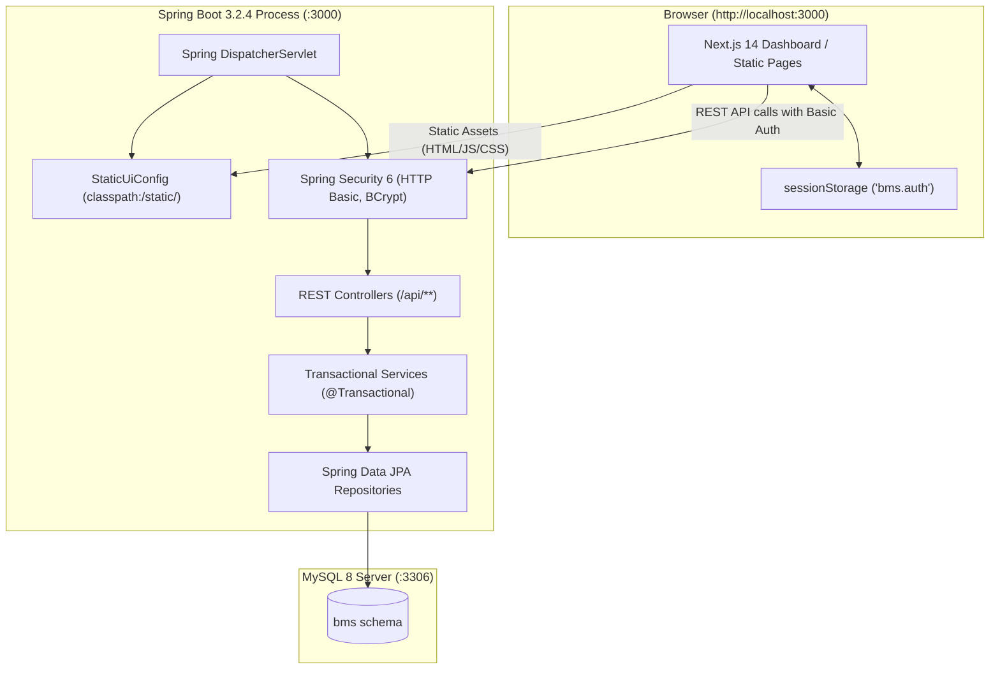
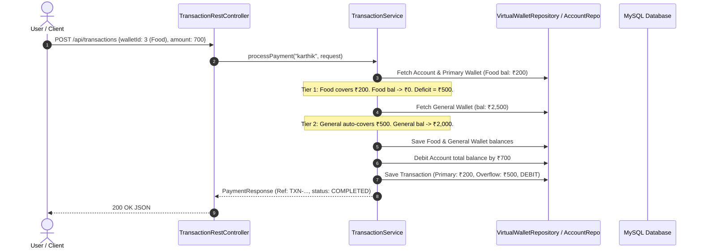

# BMS (Banking Management System) — Complete Technical Architecture & Code Walkthrough

> **Overview Document**: This file serves as an end-to-end architectural and technical guide for BMS. It outlines the technology stack, database schema, underlying design patterns, and core business engines along with critical code snippets to provide complete context of the project.

---

## 1. Project Overview & Architectural Principles

BMS models a bank account system where user funds are logically partitioned across **Virtual Wallets** (e.g., General, Savings, Food, Travel, Shopping). Spending does not draw from an opaque balance pool; instead, it utilizes a deterministic **Multi-Tier Overflow Payment Engine**.

### Core Ledger Invariant
Every transaction, wallet creation, deletion, or reallocation upholds the fundamental accounting invariant:

$$\sum_{i=1}^{n} \text{virtual\_wallet}_i.\text{balance} \equiv \text{account}.\text{total\_balance}$$

### The "One Process, One Port" Model
The application avoids separate frontend and backend servers. A single Spring Boot process listening on **`http://localhost:3000`** serves:
1. **REST APIs**: Handled by Spring MVC `@RestController` classes at `/api/**`.
2. **Static SPA Dashboard**: Statically exported Next.js 14 web application served from `classpath:/static/`.
3. **OpenAPI / Swagger UI**: Interactive documentation at `/swagger-ui.html`.



---

## 2. Technology Stack

| Layer | Technology | Version | Purpose |
|---|---|---|---|
| **Backend Runtime** | Java | 21 | Core programming language |
| **Framework** | Spring Boot | 3.2.4 | Web, DI container, lifecycle management |
| **Security** | Spring Security | 6 | HTTP Basic authentication, BCrypt hashing, stateless sessions |
| **ORM / Persistence** | Spring Data JPA / Hibernate | 6.4.4 | Relational mapping, schema generation, queries |
| **Database** | MySQL | 8.x | Relational storage (`bms` schema) |
| **API Documentation** | springdoc-openapi / Swagger | 2.3.0 | Automated OpenAPI 3.0 specs and interactive UI |
| **Frontend Framework** | Next.js (App Router) | 14.2.4 | Statically exported (`output: 'export'`) SPA |
| **Styling** | Tailwind CSS | 3.4.4 | Utility-first responsive design tokens and dark mode |
| **Data Visualization** | Recharts | 3.10.1 | Allocation donuts, monthly cashflow, variance curves |
| **Icons & Utilities** | Lucide React, qrcode.react | Latest | UI icons, dynamic UPI QR code generator |

---

## 3. Database Schema & Domain Entities

The database schema consists of four relational tables managed via JPA:

```mermaid
erDiagram
    users ||--|| accounts : "owns (1:1)"
    accounts ||--o{ virtual_wallets : "contains (1:N)"
    accounts ||--o{ transactions : "records (1:N)"
    virtual_wallets ||--o{ transactions : "primaryWallet"
    virtual_wallets ||--o{ transactions : "overflowWallet"
    virtual_wallets ||--o{ transactions : "backupWallet"

    users {
        bigint id PK
        varchar(50) username UK
        varchar(255) password "BCrypt, @JsonIgnore"
        varchar(255) full_name
        varchar(255) upi_id UK
        varchar(255) email UK
        varchar(15) phone UK
        varchar(255) role "ROLE_USER"
        datetime created_at
    }

    accounts {
        bigint id PK
        varchar(30) account_number UK
        decimal(15,2) total_balance
        bigint user_id FK
        datetime created_at
        datetime updated_at
    }

    virtual_wallets {
        bigint id PK
        varchar(50) name
        varchar(50) category
        decimal(15,2) balance
        boolean is_default_general
        bigint account_id FK
        datetime created_at
        datetime updated_at
    }

    transactions {
        bigint id PK
        varchar(64) reference_number UK
        decimal(15,2) amount
        varchar(255) description
        datetime timestamp
        bigint primary_wallet_id FK
        decimal(15,2) primary_amount_deducted
        bigint overflow_wallet_id FK
        decimal(15,2) overflow_amount_deducted
        bigint backup_wallet_id FK
        decimal(15,2) backup_amount_deducted
        varchar(20) status "COMPLETED"
        varchar(20) type "PAYMENT | TRANSFER | DEPOSIT | RECEIVED"
        varchar(10) direction "CREDIT | DEBIT | INTERNAL"
        bigint account_id FK
    }
```

### Core Entity Highlights

#### 1. `Account.java`
Maintains the master balance and cascades wallet operations:
```java
@Entity
@Table(name = "accounts")
public class Account {
    @Id @GeneratedValue(strategy = GenerationType.IDENTITY)
    private Long id;

    @Column(nullable = false, unique = true, length = 30)
    private String accountNumber;

    @Column(nullable = false, precision = 15, scale = 2)
    private BigDecimal totalBalance = BigDecimal.ZERO;

    @OneToOne(fetch = FetchType.LAZY)
    @JoinColumn(name = "user_id", nullable = false)
    @JsonIgnore
    private User user;

    @OneToMany(mappedBy = "account", cascade = CascadeType.ALL, orphanRemoval = true, fetch = FetchType.LAZY)
    private List<VirtualWallet> wallets = new ArrayList<>();
    // ...
}
```

#### 2. `VirtualWallet.java`
Represents a partitioned wallet. Wallet names must be unique per account:
```java
@Entity
@Table(name = "virtual_wallets", uniqueConstraints = {
    @UniqueConstraint(columnNames = {"account_id", "name"})
})
public class VirtualWallet {
    @Id @GeneratedValue(strategy = GenerationType.IDENTITY)
    private Long id;

    @Column(nullable = false, length = 50)
    private String name;

    @Column(length = 50)
    private String category;

    @Column(nullable = false, precision = 15, scale = 2)
    private BigDecimal balance = BigDecimal.ZERO;

    @Column(nullable = false)
    private boolean isDefaultGeneral = false; // Identifies the primary overflow buffer
    // ...
}
```

#### 3. `Transaction.java`
Captures multi-tier payment deduction breakdowns and cash flow direction:
```java
@Entity
@Table(name = "transactions")
public class Transaction {
    @Id @GeneratedValue(strategy = GenerationType.IDENTITY)
    private Long id;

    @Column(nullable = false, unique = true, length = 64)
    private String referenceNumber;

    @Column(nullable = false, precision = 15, scale = 2)
    private BigDecimal amount;

    // Multi-tier deduction audit trail
    @ManyToOne(fetch = FetchType.EAGER)
    @JoinColumn(name = "primary_wallet_id", nullable = false)
    private VirtualWallet primaryWallet;
    private BigDecimal primaryAmountDeducted = BigDecimal.ZERO;

    @ManyToOne(fetch = FetchType.EAGER)
    @JoinColumn(name = "overflow_wallet_id")
    private VirtualWallet overflowWallet;
    private BigDecimal overflowAmountDeducted = BigDecimal.ZERO;

    @ManyToOne(fetch = FetchType.EAGER)
    @JoinColumn(name = "backup_wallet_id")
    private VirtualWallet backupWallet;
    private BigDecimal backupAmountDeducted = BigDecimal.ZERO;

    private String type;      // PAYMENT, TRANSFER, DEPOSIT, RECEIVED
    private String direction; // CREDIT (money in), DEBIT (money out), INTERNAL (wallet move)

    // Absolute amount getter ensures UI always receives positive values
    public BigDecimal getAmount() { return amount != null ? amount.abs() : BigDecimal.ZERO; }
}
```

---

## 4. Single-Port Static Web Routing (`StaticUiConfig.java`)

To serve the pre-compiled Next.js export alongside Spring REST endpoints on port 3000, `StaticUiConfig` registers a custom `PathResourceResolver`:

```java
@Configuration
public class StaticUiConfig implements WebMvcConfigurer {
    @Override
    public void addResourceHandlers(ResourceHandlerRegistry registry) {
        registry.addResourceHandler("/**")
                .addResourceLocations("classpath:/static/")
                .resourceChain(true)
                .addResolver(new PathResourceResolver() {
                    @Override
                    protected Resource getResource(String resourcePath, Resource location) throws IOException {
                        // 1. Never intercept REST API routes
                        if (resourcePath.startsWith("api/")) {
                            return null;
                        }
                        // 2. Resolve direct files (JS chunks, CSS, images)
                        Resource direct = location.createRelative(resourcePath);
                        if (direct.exists() && direct.isReadable()) {
                            return direct;
                        }
                        // 3. Resolve directory routes (e.g. /dashboard -> /dashboard/index.html)
                        String base = resourcePath.isEmpty() || resourcePath.endsWith("/")
                                ? resourcePath : resourcePath + "/";
                        Resource candidate = location.createRelative(base + "index.html");
                        if (candidate.exists() && candidate.isReadable()) {
                            return candidate;
                        }
                        // 4. Fallback for client-side deep links
                        if (!resourcePath.contains(".")) {
                            return location.createRelative("index.html");
                        }
                        return null;
                    }
                });
    }
}
```

---

## 5. Core Business Engines & Flow Walkthrough



### Engine 1: Multi-Tier Overflow Payment Engine (`TransactionService.java`)
When making a purchase, funds are deducted using a 3-tier cascade:
1. **Tier 1 (Primary Wallet)**: If the target wallet has enough funds, debit it entirely. If short, exhaust it to ₹0 and compute `deficit = amount - primaryDeducted`.
2. **Tier 2 (General Wallet Overflow)**: If the primary wallet is not General, the deficit is absorbed by the default General wallet. If General can cover it, the payment succeeds automatically.
3. **Tier 3 (Interactive Backup Wallet)**: If General wallet is also exhausted:
   - If the caller provided a `backupWalletId` with sufficient funds, the remainder is deducted from the backup wallet (three-way split).
   - If no backup wallet was provided, the transaction is **rolled back** and throws `InsufficientFundsNeedBackupException`. The client receives an HTTP 400 with a list of `eligibleWallets` (non-General wallets where `balance >= remainingDeficit`), prompting the user to select one.

```java
// Core snippet from TransactionService.processPayment:
if (primaryBalance.compareTo(amount) >= 0) {
    // Tier 1: Direct coverage
    primaryDeducted = amount;
    primaryWallet.setBalance(primaryBalance.subtract(amount));
} else {
    // Primary insufficient -> drain to zero
    primaryDeducted = primaryBalance;
    primaryWallet.setBalance(BigDecimal.ZERO);
    BigDecimal deficit = amount.subtract(primaryDeducted);

    if (primaryWallet.isDefaultGeneral()) {
        // General was primary and is insufficient -> require Tier 3 backup wallet
        if (request.getBackupWalletId() != null) {
            backupWallet = resolveAndDeductBackup(request.getBackupWalletId(), deficit, account);
            backupDeducted = deficit;
        } else {
            List<BackupWalletOption> eligible = getEligibleBackupWallets(account.getId(), primaryWallet.getId(), deficit);
            throw new InsufficientFundsNeedBackupException(amount, primaryBalance, BigDecimal.ZERO, deficit, eligible);
        }
    } else {
        // Tier 2: Overflow into General Wallet
        overflowWallet = generalWallet;
        BigDecimal generalBalance = generalWallet.getBalance();
        if (generalBalance.compareTo(deficit) >= 0) {
            overflowDeducted = deficit;
            generalWallet.setBalance(generalBalance.subtract(deficit));
        } else {
            // Tier 3: General also insufficient -> require backup wallet
            overflowDeducted = generalBalance;
            generalWallet.setBalance(BigDecimal.ZERO);
            BigDecimal remainingDeficit = deficit.subtract(overflowDeducted);

            if (request.getBackupWalletId() != null) {
                backupWallet = resolveAndDeductBackup(request.getBackupWalletId(), remainingDeficit, account);
                backupDeducted = remainingDeficit;
            } else {
                List<BackupWalletOption> eligible = getEligibleBackupWallets(account.getId(), primaryWallet.getId(), remainingDeficit);
                throw new InsufficientFundsNeedBackupException(amount, primaryDeducted, generalBalance, remainingDeficit, eligible);
            }
        }
    }
}
// Uphold invariant: deduct total from master account
account.setTotalBalance(account.getTotalBalance().subtract(amount));
```

---

### Engine 2: Inter-Account Transfer & Phone Lookup (`AccountService.java` & `UserService.java`)
Supports transfers via:
- **Phone Number**: Debounced `GET /api/auth/lookup?phone=9876504321` returns verified payee card before sending.
- **UPI ID**: Matches `<username>@okbms`.
- **Account Number**: Direct transfer (e.g. `BMS0002`).

During execution:
1. Sender's selected wallet (or General wallet) funds the transfer (with overflow support).
2. Sender's account balance is debited.
3. Recipient's General wallet and master account balance are credited.
4. Two ledger rows are logged atomically: `DEBIT` on sender, `CREDIT` on recipient.

```java
// Core snippet from AccountService.transferBetweenAccounts:
fromAccount.setTotalBalance(fromAccount.getTotalBalance().subtract(amount));
toGeneral.setBalance(toGeneral.getBalance().add(amount));
toAccount.setTotalBalance(toAccount.getTotalBalance().add(amount));

// Sender audit record (DEBIT)
Transaction outTx = new Transaction();
outTx.setReferenceNumber("TRF-" + UUID.randomUUID().toString().substring(0, 8).toUpperCase());
outTx.setAmount(amount);
outTx.setDirection("DEBIT");
outTx.setType("TRANSFER");
outTx.setPrimaryWallet(fromWallet);
outTx.setAccount(fromAccount);
transactionRepository.save(outTx);

// Recipient audit record (CREDIT)
Transaction inTx = new Transaction();
inTx.setReferenceNumber("REC-" + UUID.randomUUID().toString().substring(0, 8).toUpperCase());
inTx.setAmount(amount);
inTx.setDirection("CREDIT");
inTx.setType("TRANSFER");
inTx.setPrimaryWallet(toGeneral);
inTx.setAccount(toAccount);
transactionRepository.save(inTx);
```

---

### Engine 3: Virtual Wallet Management & Allocations (`WalletService.java`)
- **Creating a Wallet**: The initial allocation is deducted from the General wallet so total account balance remains unchanged.
- **Deleting a Wallet**: The default General wallet cannot be deleted. Any remaining balance in a deleted wallet is refunded back to the General wallet.
- **Reallocation**: Allows rebalancing all wallets simultaneously, enforcing $\sum \text{allocations} \equiv \text{totalBalance}$.
- **Category System**: Wallets can be tagged with categories (*Groceries & Dining*, *Commute & Transit*, *Emergency & Savings*) for budgeting and analytics.

```java
// Core snippet from WalletService.reallocateWallets:
BigDecimal newTotal = BigDecimal.ZERO;
for (WalletReallocationItem item : request.getAllocations()) {
    if (item.getNewBalance().compareTo(BigDecimal.ZERO) < 0) {
        throw new IllegalArgumentException("Wallet balance cannot be negative");
    }
    newTotal = newTotal.add(item.getNewBalance());
}
if (newTotal.compareTo(account.getTotalBalance()) != 0) {
    throw new IllegalArgumentException("Total reallocation (₹" + newTotal +
            ") must equal total account balance (₹" + account.getTotalBalance() + ")");
}
```

---

### Engine 4: Probability & Statistics (P&S) Analytics Engine (`AnalyticsService.java`)
Analyzes completed primary wallet transactions and produces mathematical metrics:

$$\text{Mean } \mu = \frac{\sum x_i}{n}, \quad \text{Sample Variance } s^2 = \frac{\sum (x_i - \bar{x})^2}{n - 1}, \quad \text{Std Dev } s = \sqrt{s^2}$$

$$\text{Quartiles: } Q_1, \text{ Median } (Q_2), Q_3, \quad \text{Interquartile Range } (IQR) = Q_3 - Q_1$$

$$\text{Empirical Probability: } P(X > k) = \frac{\text{count}(X > k)}{n}$$

```java
// Core snippet from AnalyticsService.calculateWalletStatistics:
double meanVal = totalSpent.doubleValue() / n;
double varianceVal = 0.0;
if (n > 1) {
    double sumSquaredDiff = 0.0;
    for (Double x : amounts) {
        sumSquaredDiff += Math.pow(x - meanVal, 2);
    }
    varianceVal = sumSquaredDiff / (n - 1);
}
double stdDevVal = Math.sqrt(varianceVal);

// Empirical probability measure
long countAbove = amounts.stream().filter(val -> val > threshold.doubleValue()).count();
double probAbove = (double) countAbove / n;
```

---

## 6. REST API Reference

| Endpoint | Method | Security | Description |
|---|---|---|---|
| `/api/auth/register` | `POST` | Public | Register new user + account with ₹10,000 + General wallet |
| `/api/auth/login` | `POST` | Public | Authenticate username & password |
| `/api/auth/me` | `GET` | Authenticated | Current user profile, UPI ID, account number |
| `/api/auth/lookup?phone=` | `GET` | Public | Resolve 10-digit mobile number to payee details |
| `/api/account` | `GET` | Authenticated | Full account details + wallet balances + `balanced` boolean |
| `/api/account/summary` | `GET` | Authenticated | Dashboard summary (total balance, available balance) |
| `/api/account/deposit` | `POST` | Authenticated | Deposit funds (credits General wallet & master balance) |
| `/api/account/transfer` | `POST` | Authenticated | Inter-account transfer (by UPI, account no, or phone) |
| `/api/wallets` | `GET` | Authenticated | List all virtual wallets with allocation percentage |
| `/api/wallets` | `POST` | Authenticated | Create new wallet (funds deducted from General) |
| `/api/wallets/transfer` | `POST` | Authenticated | Internal wallet-to-wallet allocation transfer |
| `/api/wallets/reallocate` | `POST` | Authenticated | Rebalance all wallet allocations |
| `/api/wallets/{id}` | `PUT` | Authenticated | Rename wallet (balance untouched) |
| `/api/wallets/{id}` | `DELETE`| Authenticated | Delete wallet (refunds balance to General) |
| `/api/transactions` | `POST` | Authenticated | Process multi-tier overflow payment |
| `/api/transactions?walletId=` | `GET` | Authenticated | Chronological transaction ledger |
| `/api/analytics/{walletId}` | `GET` | Authenticated | Compute P&S descriptive statistics & $P(X > k)$ |

---

## 7. Frontend Integration & UI Flow

### Dual-Footer Architecture
Prevents React hydration mismatches (Errors #418 / #423):
- **Pre-Login Pages** (`/login/`, `/register/`, `/about/`, `/faq/`, `/privacy/`, `/terms/`): Render public navigation links (Login, Register, About BMS, FAQs, Privacy Policy, Terms).
- **Post-Login Pages** (`/dashboard/`, `/transfers/`, `/analytics/`, `/profile/`): Render authenticated workspace links (Dashboard, Send Money, Wallets, History, Sign Out).

### Ledger History Display
- All amounts returned by `/api/transactions` are formatted as positive absolute numbers.
- Direction is visually encoded: `CREDIT` appears in emerald green with `+`, `DEBIT` appears in rose red with `-`, and `INTERNAL` appears as neutral blue.

### Session Management
- Authentication credentials (`{username, password}`) are stored in `sessionStorage["bms.auth"]`.
- The fetch wrapper (`api.ts`) transmits `Authorization: Basic base64(username:password)` on every request.
- Receiving an HTTP 401 clears the session and routes to `/login/?reason=session`.

---

## 8. Seed Data & Demo Accounts

Initialized automatically by `DataInitializer.java` on application startup:

- **Single Bank Ecosystem**: **BMS Bank** (IFSC prefix `BMSB0001001`, UPI handle `@okbms`).
- **Default Credentials**: All demo users share password **`password123`**.

| Username | Full Name | UPI Handle | Account No | Mobile Number | Role |
|---|---|---|---|---|---|
| `karthik` | R.V.S.V. Karthik | `karthik@okbms` | ACC-100234 | `9876543210` | `ROLE_USER` (Admin) |
| `priya` | Priya Krishnan | `priya@okbms` | BMS0002 | `9876504321` | `ROLE_USER` |
| `ananya` | Ananya Iyer | `ananya@okbms` | BMS0003 | `9812345670` | `ROLE_USER` |
| `rohan` | Rohan Verma | `rohan@okbms` | BMS0004 | `9812345671` | `ROLE_USER` |
| `meera` | Meera Nair | `meera@okbms` | BMS0005 | `9812345672` | `ROLE_USER` |
| `arjun` | Arjun Mehta | `arjun@okbms` | BMS0006 | `9812345673` | `ROLE_USER` |
| `sneha` | Sneha Gupta | `sneha@okbms` | BMS0007 | `9812345674` | `ROLE_USER` |

### Pre-Seeded Food Wallet Transactions (19 entries)
To demonstrate the P&S Analytics Engine, the Food wallet is seeded with 19 transactions categorized into the course slide ranges:
- **₹100–200 (5 entries)**: 120, 145, 160, 180, 195
- **₹200–300 (8 entries)**: 210, 220, 235, 250, 260, 275, 280, 290
- **₹300–400 (4 entries)**: 310, 330, 350, 385
- **₹400–500 (2 entries)**: 420, 480

---

## 9. Running and Testing the Project

```powershell
# 1. Run the Spring Boot application (serves both API & UI on port 3000)
.\mvnw.cmd spring-boot:run

# 2. Run backend test suite (unit and service tests)
.\mvnw.cmd test

# 3. Refresh static web assets after edits
.\mvnw.cmd test-compile -DskipTests
```

Access the system at **`http://localhost:3000`**.
